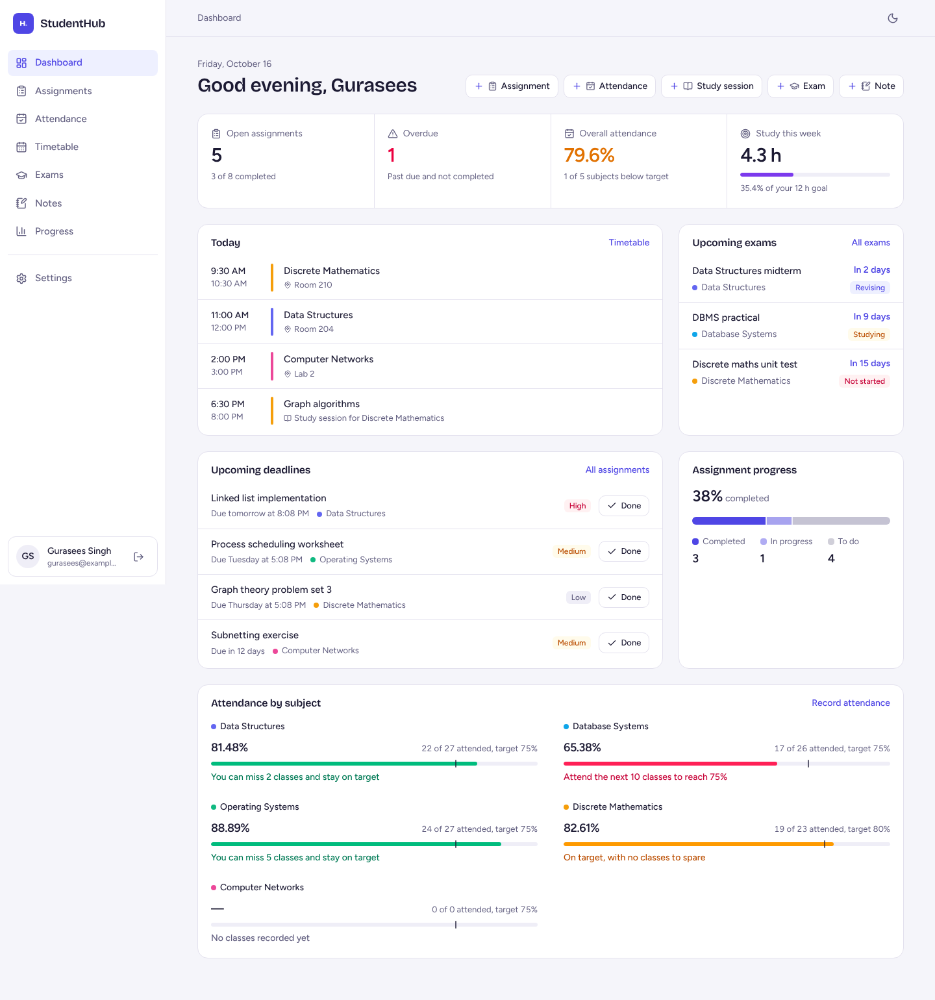
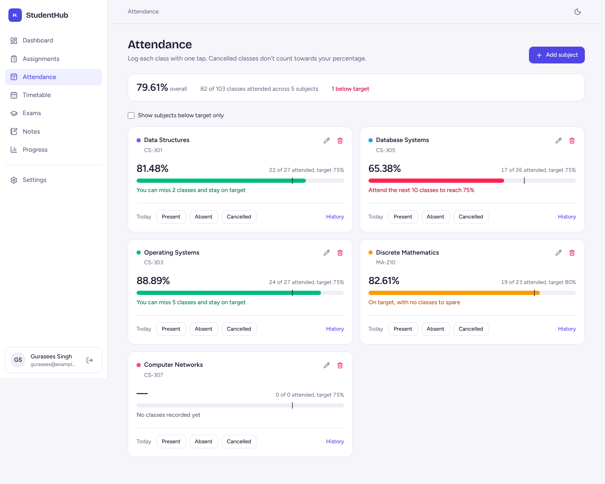
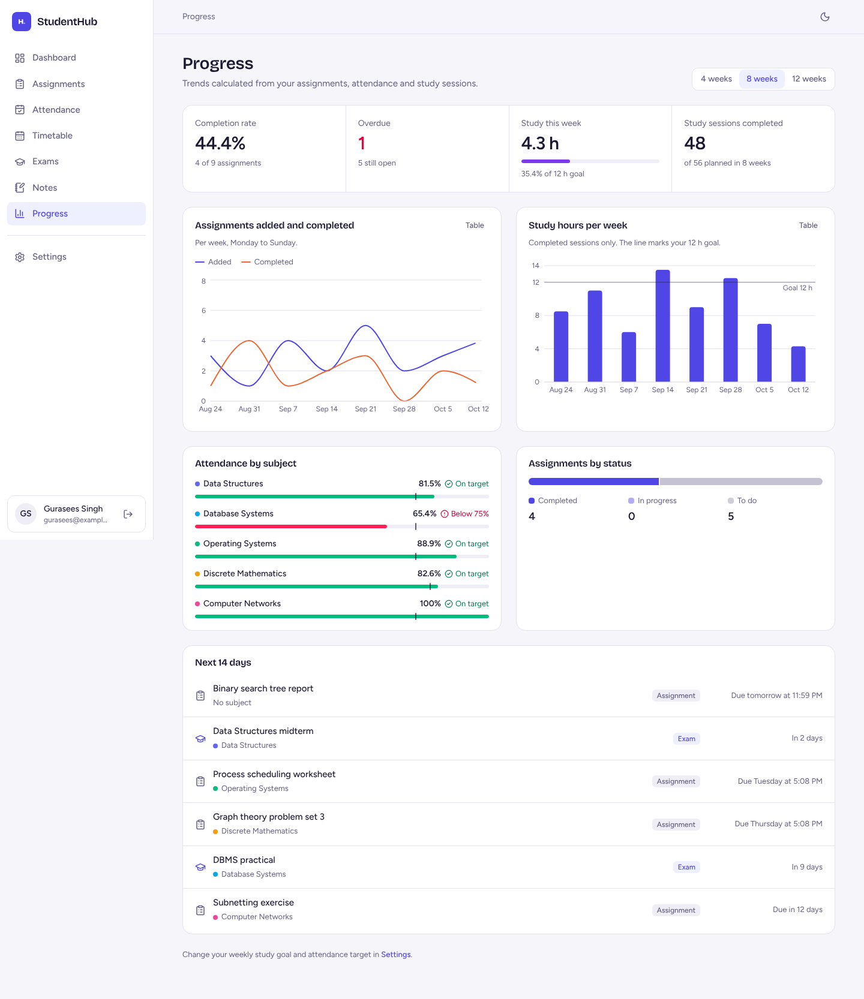
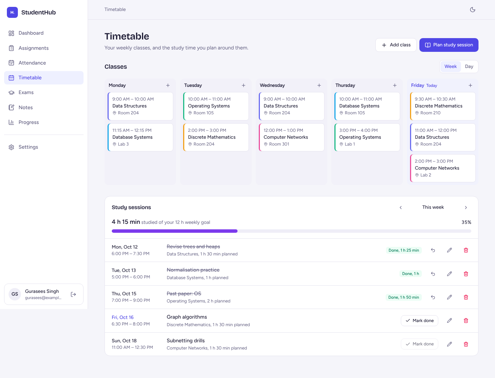
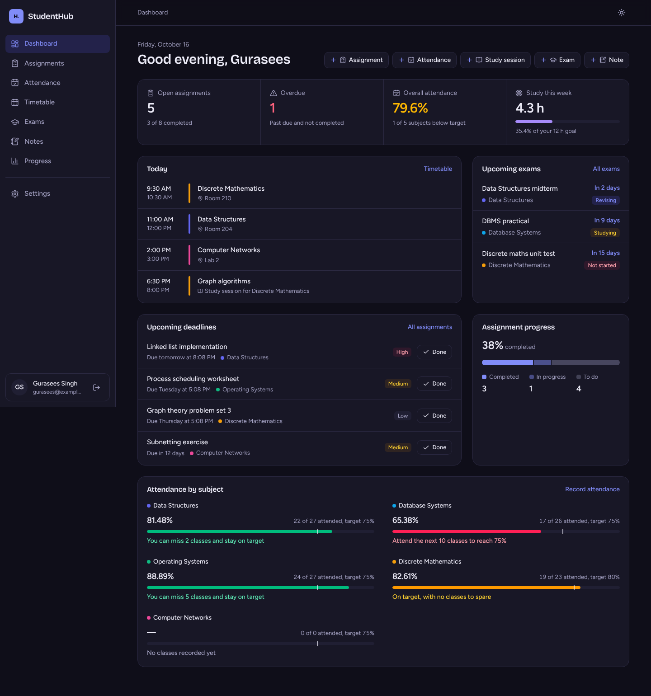
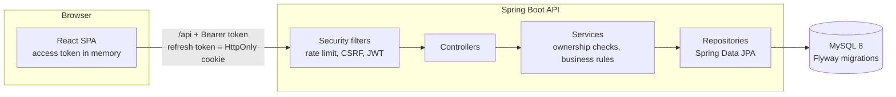

# StudentHub

A full-stack student productivity platform for tracking assignments, attendance, timetables, study sessions, exams, notes and academic progress in one place.

**React 19 + Vite + Tailwind CSS** · **Spring Boot 3.5 (Java 21) + Spring Security + JWT** · **MySQL 8 + Flyway**



<sub>Screenshots use sample data.</sub>

---

## Features

| Module | What it does |
|---|---|
| **Authentication** | Register, sign in, sign out, forgot/reset password, BCrypt hashing, short-lived JWT access tokens, rotating HttpOnly refresh cookie, STUDENT and ADMIN roles, rate-limited auth endpoints |
| **Dashboard** | Greeting, assignment counts (open, overdue, completed), overall attendance, today's classes and study sessions, upcoming exams and deadlines, weekly study goal, completion and attendance charts, quick-add actions |
| **Assignments** | Full CRUD, mark complete, search, filter by subject/priority/status/overdue, sort, pagination, overdue rows highlighted |
| **Attendance** | Subjects with targets, one-tap Present/Absent/Cancelled logging, history, percentage (cancelled classes excluded), "attend the next N classes" and "you can miss N classes" calculations, below-target filter, classes held before you started tracking |
| **Timetable and study planner** | Weekly and daily class views, overlap detection, study sessions that can't clash with classes, mark sessions done with actual minutes, weekly study goal |
| **Exams** | Countdown, preparation status, syllabus notes, nearest-first list, past exams, month calendar with assignment deadlines |
| **Notes** | Notes per subject with tags, search, pinning, timestamps |
| **Progress** | Completion rate, assignments added vs completed per week, study hours per week against the goal, attendance by subject, next 14 days. Every chart has a table view |
| **Settings** | Profile, college, course, semester, timezone, default attendance target, weekly study goal, change password, theme, delete account |
| **Admin** | Account list, enable/disable accounts (signs them out everywhere), platform totals |

All numbers are calculated by the backend from MySQL data. Nothing on the dashboard is hard-coded.

<table>
<tr>
<td></td>
<td></td>
</tr>
<tr>
<td></td>
<td></td>
</tr>
</table>

## Architecture



`controller → service → repository → MySQL`, with DTOs at the API boundary (entities are never serialised), mappers between the two, Bean Validation on every request body and a single `@RestControllerAdvice` producing one error format. Details: [docs/ARCHITECTURE.md](docs/ARCHITECTURE.md).

## Project structure

```
studenthub/
├── backend/                  Spring Boot REST API (Maven)
│   ├── src/main/java/com/studenthub/
│   │   ├── config/           Security, CORS, properties, clock, admin bootstrap
│   │   ├── controller/       REST endpoints (/api/...)
│   │   ├── service/          Business logic, attendance maths, dashboard/analytics
│   │   ├── repository/       Spring Data JPA repositories + Specifications
│   │   ├── entity/           JPA entities and enums
│   │   ├── dto/              Request/response records
│   │   ├── mapper/           Entity -> DTO mapping
│   │   ├── security/         JWT, filters, CSRF handler, rate limiter, cookies
│   │   ├── exception/        Custom exceptions + GlobalExceptionHandler
│   │   └── validation/       Custom constraints (password, time range, counts)
│   ├── src/main/resources/   application.yml, profiles, db/migration (Flyway)
│   └── src/test/             JUnit 5, Mockito, MockMvc and @DataJpaTest tests
├── frontend/                 React + Vite + Tailwind CSS
│   └── src/
│       ├── api/              Axios client (token refresh, CSRF) + endpoint functions
│       ├── components/       layout/, ui/, charts/, routing/ (reusable components)
│       ├── context/          AuthContext, ThemeContext
│       ├── hooks/            useApi, useDebounce, useSubjects
│       ├── pages/            One folder per feature
│       ├── utils/            Dates, errors, attendance wording, constants
│       └── test/             Vitest + Testing Library tests
├── database/                 Database + user setup script, schema reference
├── docs/                     Architecture, API, database, security, testing, deployment, troubleshooting, Postman
├── docker-compose.yml        MySQL + API + web in one command
└── .github/workflows/ci.yml  Runs backend tests, the MySQL migration and frontend tests on every push
```

## Getting started (local development)

### Prerequisites

| Tool | Version | Notes |
|---|---|---|
| JDK | 21 LTS (17 also works) | For Java 17, change `<java.version>` in `backend/pom.xml` |
| Maven | 3.9+ | Or use the Maven bundled with IntelliJ IDEA |
| Node.js | 22 LTS (20.19+ minimum) | Vite 8 requires Node 20.19 or newer |
| MySQL | 8.0.16+ | CHECK constraints are enforced from 8.0.16. MySQL Workbench is handy |

### 1. Create the database

Open `database/01_create_database.sql` in MySQL Workbench, **change the password** on the two `CREATE USER` lines, and run it. From a terminal:

```powershell
mysql -u root -p < database/01_create_database.sql
```

This creates the `studenthub` database and a `studenthub_app` user that can only access that database. The tables are created by Flyway when the backend first starts.

### 2. Run the backend

```powershell
cd backend
Copy-Item .env.example .env          # macOS/Linux: cp .env.example .env
```

Edit `backend/.env`:

- `DB_PASSWORD`: the password you set in step 1.
- `JWT_SECRET`: generate a new one:
  ```powershell
  # PowerShell
  $b = New-Object byte[] 64; [Security.Cryptography.RandomNumberGenerator]::Create().GetBytes($b); [Convert]::ToBase64String($b)
  ```
  ```bash
  # macOS / Linux / Git Bash
  openssl rand -base64 64
  ```
- Keep `COOKIE_SECURE=false` for local HTTP.

Then start it:

```powershell
mvn spring-boot:run
```

The API listens on http://localhost:8080. Check http://localhost:8080/actuator/health, which should return `{"status":"UP"}`. In IntelliJ, open the `backend` folder and run `StudentHubApplication` (the working directory must be `backend/` so that `.env` is found).

### 3. Run the frontend

```powershell
cd frontend
npm install
npm run dev
```

Open http://localhost:5173. The Vite dev server forwards `/api` to the backend, so the browser sees a single origin and cookies work without CORS.

### Optional: everything with Docker

```powershell
Copy-Item .env.example .env   # then fill in DB_PASSWORD, MYSQL_ROOT_PASSWORD and JWT_SECRET
docker compose up --build
```

Open http://localhost:3000.

### Optional: an admin account

Set `ADMIN_EMAIL` and `ADMIN_PASSWORD` (12+ characters) in `backend/.env` before starting. The account is created on startup if that email isn't already registered. Public registration only ever creates students.

## Environment variables (backend)

| Variable | Required | Default | Purpose |
|---|---|---|---|
| `DB_URL` | no | `jdbc:mysql://localhost:3306/studenthub?...` | JDBC URL |
| `DB_USERNAME` | no | `studenthub_app` | Database user |
| `DB_PASSWORD` | **yes** |  | Database password |
| `JWT_SECRET` | **yes** |  | Base64 HMAC key, at least 256 bits. The app refuses to start without it |
| `JWT_ACCESS_TTL` / `JWT_REFRESH_TTL` | no | `15m` / `7d` | Token lifetimes |
| `COOKIE_SECURE` | no | `true` | Set `false` only for local HTTP |
| `CORS_ALLOWED_ORIGINS` | no | `http://localhost:5173` | Comma-separated trusted origins |
| `FRONTEND_URL` | no | `http://localhost:5173` | Used to build password reset links |
| `MAIL_ENABLED`, `MAIL_HOST`, `MAIL_PORT`, `MAIL_USERNAME`, `MAIL_PASSWORD`, `MAIL_FROM` | no | `false` | SMTP for reset emails. When disabled, links are printed to the console |
| `ADMIN_EMAIL`, `ADMIN_PASSWORD` | no |  | Bootstrap admin |
| `FORWARD_HEADERS_STRATEGY` | no | `none` (`framework` in prod profile) | Trust `X-Forwarded-For` behind a proxy |
| `SPRING_PROFILES_ACTIVE` | no |  | `dev` or `prod` |

Frontend: `frontend/.env.example` (`VITE_API_BASE_URL`, `VITE_DEV_BACKEND_URL`). Never put secrets in frontend env files: they end up in the public bundle.

## API overview

| Area | Endpoints |
|---|---|
| Auth | `POST /api/auth/register`, `/login`, `/refresh`, `/logout`, `/forgot-password`, `/reset-password`, `GET /api/auth/csrf` |
| Profile | `GET/PUT/DELETE /api/users/me`, `PUT /api/users/me/password` |
| Assignments | `GET/POST /api/assignments`, `GET/PUT/DELETE /api/assignments/{id}`, `PATCH /api/assignments/{id}/status` |
| Subjects & attendance | `GET/POST /api/subjects`, `GET/PUT/DELETE /api/subjects/{id}`, `GET/POST /api/subjects/{id}/attendance`, `PUT/DELETE /api/attendance/{id}` |
| Timetable | `GET/POST /api/timetable`, `PUT/DELETE /api/timetable/{id}` |
| Study sessions | `GET/POST /api/study-sessions`, `PUT/DELETE /api/study-sessions/{id}`, `PATCH /api/study-sessions/{id}/completion` |
| Exams | `GET/POST /api/exams`, `GET/PUT/DELETE /api/exams/{id}` |
| Notes | `GET/POST /api/notes`, `GET /api/notes/tags`, `GET/PUT/DELETE /api/notes/{id}`, `PATCH /api/notes/{id}/pin` |
| Dashboard | `GET /api/dashboard/summary`, `GET /api/dashboard/analytics?weeks=8` |
| Admin | `GET /api/admin/users`, `GET /api/admin/stats`, `PATCH /api/admin/users/{id}/status` |

Full reference with status codes and examples: [docs/API.md](docs/API.md). Postman collection: [docs/postman/StudentHub.postman_collection.json](docs/postman/StudentHub.postman_collection.json).

## Testing

```powershell
cd backend;  mvn test        # JUnit 5 + Mockito + MockMvc + @DataJpaTest on in-memory H2
cd frontend; npm test        # Vitest + React Testing Library
```

What the tests cover (auth, ownership, validation, attendance maths, overdue logic, rate limiting, JWT, repositories) is listed in [docs/TESTING.md](docs/TESTING.md).

## Security highlights

- Passwords hashed with BCrypt (strength 12). Hashes and secrets never appear in responses.
- Access token (15 min) kept **in memory only**. Refresh token in an **HttpOnly, Secure, SameSite=Strict** cookie scoped to `/api/auth`, rotated on every use, stored as a SHA-256 hash, with reuse detection.
- CSRF protection on the two cookie-authenticated endpoints (`/auth/refresh`, `/auth/logout`). Every other endpoint uses the `Authorization` header, which browsers never attach automatically.
- The user id always comes from the verified token. Every query is scoped to the owner, and other users' records answer **404**.
- Password reset never reveals whether an email is registered. Reset tokens are single-use and expire after 30 minutes. A reset signs out every device.
- Rate limiting on login, register, forgot/reset password and refresh. CORS limited to configured origins. No stack traces in responses.

The reasoning and trade-offs are in [docs/SECURITY.md](docs/SECURITY.md).

## Documentation

- [Architecture and build phases](docs/ARCHITECTURE.md)
- [Database design](docs/DATABASE.md)
- [API reference](docs/API.md)
- [Security](docs/SECURITY.md)
- [Testing and Postman](docs/TESTING.md)
- [Deployment](docs/DEPLOYMENT.md)
- [Troubleshooting](docs/TROUBLESHOOTING.md)
- [What has been verified](docs/VERIFICATION.md)
