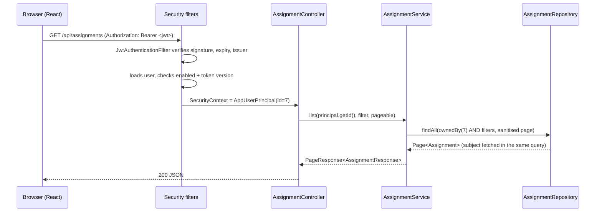
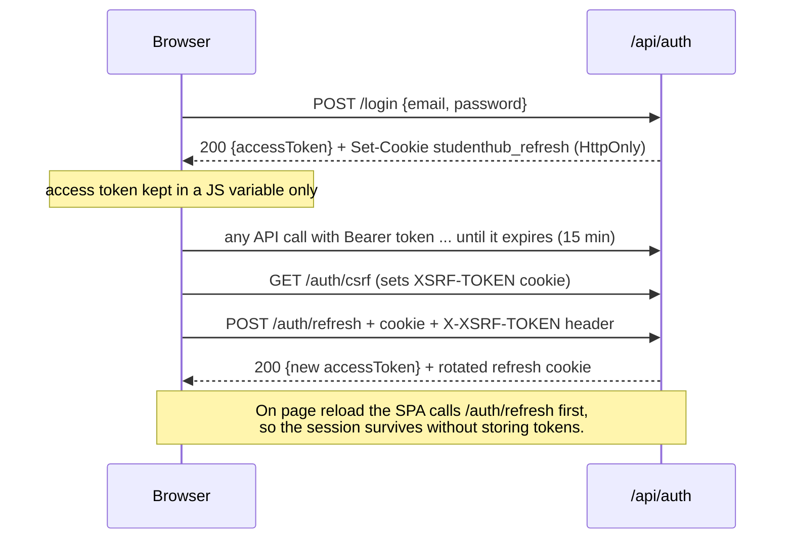

# Architecture

## Overview

StudentHub is a single-page React application talking to a stateless Spring Boot REST API backed by MySQL.

```mermaid
flowchart TB
  subgraph Frontend["frontend/ (React 19, Vite, Tailwind)"]
    Pages[pages/*] --> Hooks[hooks: useApi, useSubjects]
    Pages --> UI[components/ui, layout, charts]
    Hooks --> Services[api/services.js]
    Services --> Client[api/client.js<br/>Axios: Bearer token, 401 refresh, CSRF header]
    Auth[context/AuthContext] --> Client
  end
  subgraph Backend["backend/ (Spring Boot 3.5, Java 21)"]
    direction TB
    Filters[Security filter chain<br/>CORS, RateLimitFilter, CsrfFilter, JwtAuthenticationFilter]
    Controllers[controller/*<br/>@RestController, @Valid DTOs]
    Services2[service/*<br/>@Transactional, ownership checks]
    Repos[repository/*<br/>Spring Data JPA, Specifications]
    Advice[exception/GlobalExceptionHandler]
    Filters --> Controllers --> Services2 --> Repos
    Controllers -.errors.-> Advice
  end
  Client -- "HTTP /api" --> Filters
  Repos --> MySQL[(MySQL 8)]
  Flyway[Flyway V1__create_schema.sql] --> MySQL
```

## Backend layers

| Package | Responsibility |
|---|---|
| `controller` | HTTP only: routes, status codes, `@Valid` request DTOs, reads the current user with `@AuthenticationPrincipal`. No business logic. |
| `service` | Business rules and transactions. Every method receives the **authenticated user's id** and only reads or writes that user's rows. Also holds `AttendanceCalculator` (pure maths), `DashboardService` and `AnalyticsService` (aggregation). |
| `repository` | Spring Data JPA interfaces. Every lookup is owner-scoped (`findByIdAndUserId`). `repository/spec` builds dynamic filters with JPA Specifications. |
| `entity` | JPA entities mapped to the Flyway schema (`ddl-auto=validate`). No bidirectional collections on `User`, so loading a user never loads their history. |
| `dto` | Java records for requests and responses. Entities never leave the service layer, so password hashes and internals can't leak by accident. |
| `mapper` | Static entity-to-DTO mapping functions. |
| `security` | JWT issuing and parsing, the JWT filter, the CSRF request handler, rate limiting, refresh cookie handling, JSON 401/403 responses. |
| `config` | `SecurityConfig`, `CorsConfig`, typed `AppProperties`, the `Clock` bean, `AdminBootstrap`. |
| `exception` | Custom exceptions and the `@RestControllerAdvice` that turns everything into the `ApiError` JSON shape. |
| `validation` | Custom Bean Validation constraints: `@StrongPassword`, `@ValidTimeZone`, `@ValidTimeRange`, `@ValidAttendanceCounts`. |

### Request lifecycle (authenticated call)



### Session lifecycle



## Frontend structure

| Folder | Contents |
|---|---|
| `api/` | `client.js`: Axios instance that adds the bearer token and the `X-XSRF-TOKEN` header, retries once after a silent refresh on 401, and shares a single in-flight refresh between concurrent calls. `services.js` has one object per API area. `tokenStore.js` holds the in-memory access token. |
| `context/` | `AuthContext` (restores the session on load, login/register/logout), `ThemeContext` (light/dark, remembered per device). |
| `components/ui/` | Reusable building blocks: `Button`, `FormInput`, `SelectInput`, `TextArea`, `Modal`, `ConfirmDialog`, `DataTable`, `Pagination`, `DashboardCard`, `Badge`, `ProgressBar`, `LoadingSpinner`, `Skeleton`, `EmptyState`, `ErrorState`, `ThemeToggle`, `Layout` (`PageHeader`, `Panel`, `SearchInput`, `Segmented`). |
| `components/layout/` | `AppLayout`, `Sidebar`, `Navbar`, `MobileNav`, `Logo`. |
| `components/routing/` | `ProtectedRoute` (with optional `roles`), `PublicOnlyRoute`. |
| `components/charts/` | `ChartFrame` (title, legend, table view), `AssignmentStatusBar`, chart colours. |
| `pages/` | One folder per feature, each with its page and modals. Pages are lazy-loaded so the landing page doesn't download chart code. |

## Key design decisions

- **Timezones.** Instants (due dates, exam times) are stored in UTC (`DATETIME(6)`) and shown in the browser's local time. "Today" (today's classes, the current week, "can't record attendance in the future") is computed in the timezone saved on the student's profile, because a server in UTC would otherwise get the date wrong for half the day in India.
- **Ownership returns 404, not 403.** A request for another student's record behaves exactly like a request for a record that doesn't exist, so ids can't be probed. 403 is reserved for role checks (students calling `/api/admin/**`).
- **Attendance maths is exact.** `AttendanceCalculator` uses `BigDecimal`. The percentage is displayed rounded (2 decimals, HALF_UP), but "meets target" compares the exact fraction, so 74.996% is correctly below 75%. The formulas are cross-checked against brute force in the tests.
- **Analytics are zero-filled.** Weekly series always contain every week in the range, bucketed Monday to Sunday in the student's timezone, so charts never have gaps and the frontend does no maths.
- **Sorting is whitelisted.** Clients can only sort by known fields (`PageRequests.sanitize`); anything else is a 400 rather than an exception or a probe into internal properties. Page size is capped at 100.
- **Subject deletion is deliberate.** Attendance records and timetable slots belong to a subject and are deleted with it; assignments, exams, notes and study sessions only reference it and are kept (subject set to NULL). See [DATABASE.md](DATABASE.md).

## How the build phases map to the code

| Phase | Delivered in |
|---|---|
| 1. React, Vite, Tailwind, routing, layout | `frontend/` scaffolding, `components/layout`, `components/ui`, `App.jsx`, `index.css` design tokens |
| 2. Spring Boot, Maven, MySQL, JPA, migrations | `backend/pom.xml`, `application*.yml`, `entity/`, `db/migration/V1__create_schema.sql`, `database/` |
| 3. Registration, login, BCrypt, JWT, Spring Security | `security/`, `config/SecurityConfig`, `service/AuthService`, `RefreshTokenService`, `controller/AuthController` |
| 4. Axios integration and protected routes | `api/client.js`, `context/AuthContext.jsx`, `components/routing/` |
| 5. Assignment CRUD and filtering | `AssignmentService`, `AssignmentSpecifications`, `pages/assignments/` |
| 6. Subjects and attendance calculations | `SubjectService`, `AttendanceService`, `AttendanceCalculator`, `pages/attendance/` |
| 7. Timetable, study sessions, exams | `TimetableService`, `StudySessionService`, `ExamService`, `pages/timetable/`, `pages/exams/` |
| 8. Notes, profile settings, dashboard analytics | `NoteService`, `UserService`, `DashboardService`, `AnalyticsService`, `pages/notes/`, `pages/settings/`, `pages/dashboard/`, `pages/analytics/` |
| 9. Validation, error handling, tests, security checks | `validation/`, `exception/GlobalExceptionHandler`, `src/test/` (backend), `src/test/` (frontend) |
| 10. Documentation, production builds, deployment | `README.md`, `docs/`, Dockerfiles, `docker-compose.yml`, `frontend/vercel.json`, CI workflow |

## Adding a feature (checklist)

1. Add a Flyway migration `V2__describe_change.sql` (never edit V1 once it has run anywhere).
2. Add or update the entity to match; `ddl-auto=validate` will fail fast if they disagree.
3. Add request/response records in `dto/` and a mapper.
4. Add the repository method, owner-scoped.
5. Add the service method taking `Long userId`, annotated `@Transactional` if it writes.
6. Add the controller endpoint with `@Valid` and `@AuthenticationPrincipal`.
7. Add tests: service (Mockito) and an integration test including a cross-user 404 case.
8. Add the API function in `frontend/src/api/services.js` and the UI.
