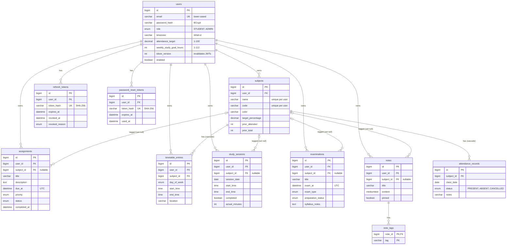

# Database design

MySQL 8.0.16+ (`utf8mb4`, `utf8mb4_0900_ai_ci`), InnoDB. The schema is created and versioned by Flyway from `backend/src/main/resources/db/migration`. Hibernate runs with `ddl-auto=validate`: it checks the entities against the schema at startup but never changes it.

## Entity relationship diagram

Every table except `note_tags` also has `created_at` and `updated_at` (`DATETIME(6)`, UTC), set by Hibernate's `@CreationTimestamp` / `@UpdateTimestamp`. The token tables have `created_at` only.

## How the tables relate

- **Ownership.** Every academic table has `user_id → users(id) ON DELETE CASCADE`. Deleting an account (Settings → Delete account) removes every row that belonged to it in one statement.
- **Attendance belongs to a subject.** `attendance_records` has no `user_id`; ownership is `record → subject → user`. Records are meaningless without their subject, so `ON DELETE CASCADE`.
- **Timetable slots belong to a subject.** A class slot always has a subject (`NOT NULL`), and is removed with it (`ON DELETE CASCADE`).
- **Other work only references a subject.** Assignments, exams, notes and study sessions have a nullable `subject_id` with `ON DELETE SET NULL`. Deleting "Physics" must not delete the Physics assignment a student already submitted.
- **Cross-user references are blocked in the service layer.** The database can't express "the subject must belong to the same user" without composite keys that would break `SET NULL`, so services only ever resolve subjects with `findByIdAndUserId(subjectId, currentUserId)`.

## Constraints

| Table | Constraint | Why |
|---|---|---|
| users | `UNIQUE(email)` with a case-insensitive collation | One account per email, regardless of case (the app also lower-cases emails) |
| users | `CHECK attendance_target BETWEEN 1 AND 100`, `semester 1-12`, `weekly_study_goal_hours 1-112` | Mirrors the API validation |
| subjects | `UNIQUE(user_id, name)`, `UNIQUE(user_id, code)` | No duplicate subjects per student; different students can use the same names |
| subjects | `CHECK prior_attended <= prior_total`, both `>= 0`, target 1-100 | Attendance counts can't be impossible |
| timetable_entries, study_sessions | `CHECK end_time > start_time` | No zero-length or overnight slots |
| study_sessions | `CHECK actual_minutes BETWEEN 1 AND 1440` | At most one day |
| examinations | `CHECK duration_minutes BETWEEN 5 AND 600` | Sensible exam lengths |
| all enums | native MySQL `ENUM` | Invalid states are rejected by the database too |

Overlapping class slots and study sessions are rejected by the service layer (409), since a range-overlap rule can't be a simple constraint in MySQL.

## Indexes

Chosen for the queries the app actually runs:

| Index | Serves |
|---|---|
| `assignments(user_id, due_at)` | Assignment list sorted by due date, upcoming deadlines, overdue count |
| `assignments(user_id, status)` | Dashboard counts by status |
| `assignments(user_id, completed_at)` | Completion trend |
| `attendance_records(subject_id, class_date)` | History pages and per-subject counts |
| `timetable_entries(user_id, day_of_week, start_time)` | Today's classes, overlap checks |
| `study_sessions(user_id, session_date, start_time)` | Week view, weekly minutes, overlap checks |
| `examinations(user_id, exam_at)` | Upcoming exams, calendar months |
| `notes(user_id, pinned, updated_at)` | Notes list (pinned first, then recently edited) |
| `note_tags(tag)` | Tag filter |
| `refresh_tokens(user_id, revoked_at)`, `token_hash` unique | Revoke-all and token lookup |
| `*_tokens(expires_at)` | Nightly cleanup job |

Foreign keys get their own index automatically when no existing index starts with the FK column.

## Type choices

| Data | Column type | Java type |
|---|---|---|
| Moments in time (due dates, exam times, audit timestamps) | `DATETIME(6)` in UTC | `Instant` (Hibernate configured with `jdbc.time_zone=UTC`, `preferred_instant_jdbc_type=TIMESTAMP`) |
| Calendar dates (class date, study date) | `DATE` | `LocalDate` |
| Clock times (timetable) | `TIME` | `LocalTime` |
| Percentages | `DECIMAL(5,2)` | `BigDecimal` (no floating-point drift) |
| Enums | `ENUM(...)` | Java enum with `@Enumerated(EnumType.STRING)` |
| Long text | `TEXT` / `MEDIUMTEXT` (notes, up to 50,000 characters) | `String` |

`DATETIME` rather than `TIMESTAMP` because MySQL's `TIMESTAMP` stops at 2038.

## Changing the schema

1. Create `backend/src/main/resources/db/migration/V2__short_description.sql`.
2. Update the matching entity.
3. Restart the backend. Flyway applies new migrations in order and records them in `flyway_schema_history`.

Never edit a migration that has already run on any database; Flyway checksums would fail. In MySQL Workbench, *Database → Reverse Engineer* on the `studenthub` schema draws the same diagram as above.
